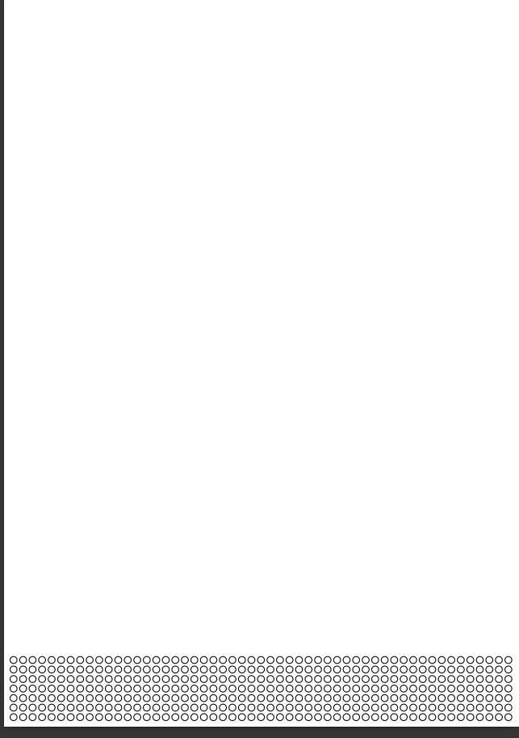

# Calendar Circles

This program generates a 7x53 matrix of circles to simulate a calendar format. 

The following image shows the PDF result generated by the program.

This program is built using the ReportLab library to generate the PDF calendar.

